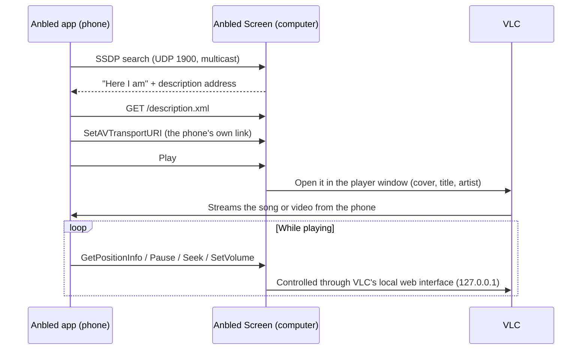

<div align="center">


# Anbled Screen

**Cast songs and videos from the Anbled app to your Linux or Windows computer.**

Anbled Screen makes your computer a cast receiver. It shows up in the Anbled app's **Cast** list just like a smart
TV. What you cast opens in a real player window, with the cover, title and controls, on your bigger screen.

[](https://github.com/vitroyfix/anbled-screen/actions/workflows/test.yml)
[](#linux)
[](#windows)
[](#requirements)
[](#how-it-works)
[](#requirements)

[Quick start](#quick-start) ·
[Installation](#installation) ·
[Usage](#usage) ·
[How it works](#how-it-works) ·
[Troubleshooting](#troubleshooting)

</div>

---

## Overview

The [Anbled](https://anbled.com) Android app can cast to Chromecast devices and smart TVs. Anbled Screen adds
your computer to that list. Pick it in the app, and what you're playing moves to the computer. Your phone stays the
remote control for play, pause, seek, volume and skipping songs, and the computer gets a full player window with
the same controls.

| | |
|---|---|
| 🖥️ **A real player window** | Resize it, move it, go full screen and back, or close it. Play, pause, seek and volume work on the computer too. |
| 🎵 **Songs with their cover** | Songs show their cover, title and artist. Videos play in the same window. |
| 🔄 **Phone and computer in sync** | Whatever you do on one shows on the other. Closing the window pauses, and Play on the phone reopens it where you left off. |
| 📡 **Found automatically** | No addresses or pairing codes. Phones on the same Wi-Fi find it on their own. |
| 🪶 **Lightweight** | One Python file, standard library only, playback by [VLC](https://www.videolan.org/vlc/). |
| 🔒 **Local only** | Only phones on your home network can control it, and it plays only what the casting phone itself serves. |
| 💻 **Linux and Windows** | Fedora, Ubuntu, Debian, Mint, Arch, openSUSE and other systemd distributions, plus Windows 10 and 11. |

## Quick start

**Linux** (in a terminal):

```bash
curl -fsSL https://raw.githubusercontent.com/vitroyfix/anbled-screen/main/install.sh | bash
anbled-screen
```

**Windows** (in PowerShell):

```powershell
irm https://raw.githubusercontent.com/vitroyfix/anbled-screen/main/windows/install.ps1 | iex
```

Then, on your phone:

1. Connect to the **same Wi-Fi** as the computer.
2. Open **Anbled** and play something.
3. Tap **Cast** and choose **Anbled screen (Linux)** or **Anbled screen (Windows)**.

## Requirements

| Requirement | Linux | Windows |
|---|---|---|
| **System** | Any distribution with systemd | Windows 10 or 11 |
| **Python 3.9+** | Already installed on all current distributions | Installed for you with winget if missing |
| **VLC** | Your distribution's package or the Flatpak (see below) | Installed for you with winget if missing |
| **Network** | Same Wi-Fi or LAN as the phone | Same Wi-Fi or LAN as the phone, set to a **Private** network |

Install VLC on Linux if you don't have it:

| Distribution | Command |
|---|---|
| Fedora, RHEL, CentOS | `sudo dnf install vlc` |
| Ubuntu, Debian, Mint, Pop!_OS | `sudo apt install vlc` |
| Arch, Manjaro, EndeavourOS | `sudo pacman -S vlc` |
| openSUSE | `sudo zypper install vlc` |
| Any (Flatpak) | `flatpak install flathub org.videolan.VLC` |

## Installation

### Linux

```bash
curl -fsSL https://raw.githubusercontent.com/vitroyfix/anbled-screen/main/install.sh | bash
```

No `curl`? Use `wget -qO- https://raw.githubusercontent.com/vitroyfix/anbled-screen/main/install.sh | bash`.
To install from a clone instead, run `./install.sh` in it.

Everything goes in your home folder. Nothing is installed system-wide:

| File | Purpose |
|---|---|
| `~/.local/share/anbled-screen/anbled_screen.py` | The receiver |
| `~/.local/bin/anbled-screen` | The command you run |
| `~/.config/systemd/user/anbled-screen.service` | Keeps it running in the background |
| `~/.local/share/applications/anbled-screen.desktop` | The entry in your applications menu |

### Windows

Open **PowerShell** (Start menu → type *PowerShell*) and run:

```powershell
irm https://raw.githubusercontent.com/vitroyfix/anbled-screen/main/windows/install.ps1 | iex
```

The installer:

1. Finds **Python** and **VLC**, and installs them with winget if they're missing.
2. Installs Anbled Screen for your user in `%LOCALAPPDATA%\Programs\Anbled Screen`.
3. Adds **Anbled Screen** and **Turn off Anbled Screen** to the Start menu, and an entry under
   **Settings → Apps** for uninstalling.
4. Lets phones on **private** networks reach it through Windows Firewall (one administrator prompt).
5. Asks whether to start it every time you sign in, and then turns it on.

To install from a clone instead, run `.\windows\install.ps1` in it. The options are `-Autostart`, `-NoStart` and
`-Quiet`.

### Updating

Run the install command again. The new version takes over straight away.

### Uninstalling

- **Linux:** `curl -fsSL https://raw.githubusercontent.com/vitroyfix/anbled-screen/main/install.sh | bash -s -- --uninstall`
- **Windows:** **Settings → Apps → Installed apps → Anbled Screen → Uninstall**, or `.\windows\install.ps1 -Uninstall`

Python and VLC are left installed.

## Usage

### Linux

Open **Anbled Screen** from your applications menu, or use the terminal:

| Command | What it does |
|---|---|
| `anbled-screen` | Turn it on |
| `anbled-screen off` | Turn it off |
| `anbled-screen status` | Show whether it's on, and on which address |
| `anbled-screen logs` | Show recent activity |
| `anbled-screen autostart` | Start it every time you log in |
| `anbled-screen no-autostart` | Stop starting it at login |

You can also right-click the menu entry to turn it off or to start it at login.

> [!NOTE]
> The first time you turn it on, you may be asked for your password once. If your computer runs a firewall
> (**firewalld** on Fedora, openSUSE and RHEL, or **ufw** on Ubuntu and Mint), that's needed to let phones find it.

### Windows

Use the Start menu: **Anbled Screen** turns it on and **Turn off Anbled Screen** turns it off. It runs in the
background with no window until something is cast.

To use a terminal instead, run these in `%LOCALAPPDATA%\Programs\Anbled Screen`:

| Command | What it does |
|---|---|
| `python anbled_screen.py --start` | Turn it on |
| `python anbled_screen.py --stop` | Turn it off |
| `python anbled_screen.py --status` | Show whether it's on, and on which address |
| `python anbled_screen.py --autostart` | Start it every time you sign in |
| `python anbled_screen.py --no-autostart` | Stop starting it at sign-in |

The log is in `%APPDATA%\Anbled Screen\anbled-screen.log`.

### Configuration

| Variable | Default | Description |
|---|---|---|
| `ANBLED_SCREEN_NAME` | `Anbled screen (Linux)` / `(Windows)` | The name phones show in the Cast list |
| `ANBLED_SCREEN_PORT` | `49494` | TCP port for control messages (if you change it, open the new port in your firewall) |
| `ANBLED_SCREEN_VLC` | *(found automatically)* | The VLC program to use |
| `ANBLED_SCREEN_LOG` | *(off)* | A file path that VLC's own log is written to, for finding problems |

- **Linux:** run `systemctl --user edit anbled-screen`, add `Environment=ANBLED_SCREEN_NAME=Living room` under
  `[Service]`, then run `anbled-screen` again.
- **Windows:** run `setx ANBLED_SCREEN_NAME "Living room"`, then turn Anbled Screen off and on again.

## How it works

To the Anbled app, Anbled Screen is a standard **UPnP / DLNA media renderer**, the same thing a smart TV is.



1. **Discovery.** The receiver answers SSDP searches and announces itself on the network every minute, so the app
   lists it within a second or two.
2. **Casting.** The phone sends a link to a small web server running on the phone, with the song's title, artist
   and cover. Anbled Screen opens it in a VLC player window. The first song opens the window, and later songs play
   in the same one. Your choice of full screen or windowed is kept from one video to the next.
3. **Control.** Play, pause, seek and volume from the phone are passed to VLC through its web interface. That
   interface listens only on `127.0.0.1` and uses a new random password each time the window opens. The phone asks
   every second what the window is doing, so pausing or seeking on the computer shows on the phone too.
4. **Closing the window** in the middle of a song counts as a pause, so the phone doesn't skip to the next song.
   Press Play on the phone and the window opens again where it was.

## Security

Anbled Screen is designed to be safe to leave running on a home network:

- **Local network only.** It ignores control requests from addresses outside private, link-local and loopback
  ranges. On Windows, the firewall rules apply only to private networks.
- **Plays only what the casting phone serves.** A play request is accepted only for an `http(s)` link whose host is
  the phone that sent it. Local files, other computers and anything VLC might read as a command-line option are
  refused. VLC is given a playlist file Anbled Screen wrote itself, after `--`, never a raw network address.
- **Cast links stay private.** The link being played is shown only to the phone that cast it. Other devices asking
  what's playing get an empty answer.
- **No administrator rights to run.** It runs as your user. The only system change is the firewall opening.
- **Limited input.** Control requests larger than 256 KB are refused.
- **Covers from known places only.** Song pictures are downloaded only over https from Anbled's image hosts, as
  images of at most 5 MB, with no redirects.
- **Nothing in VLC's history.** Cast links aren't added to VLC's recently played list.

Found a security problem? Please report it privately to the maintainer rather than in a public issue.

## Network and firewall

| Port | Protocol | Purpose |
|---|---|---|
| `1900` | UDP (multicast `239.255.255.250`) | Discovery (SSDP) |
| `49494` | TCP | Device description and playback control |

The installers open these for you. To open them yourself:

```bash
# Linux, firewalld (Fedora, openSUSE, RHEL)
sudo firewall-cmd --permanent --add-service=ssdp
sudo firewall-cmd --permanent --add-port=49494/tcp
sudo firewall-cmd --reload

# Linux, ufw (Ubuntu, Mint)
sudo ufw allow 1900/udp
sudo ufw allow 49494/tcp
```

```powershell
# Windows (PowerShell as administrator)
New-NetFirewallRule -DisplayName 'Anbled Screen (discovery)' -Direction Inbound -Action Allow -Protocol UDP -LocalPort 1900 -Profile Private,Domain
New-NetFirewallRule -DisplayName 'Anbled Screen (control)' -Direction Inbound -Action Allow -Protocol TCP -LocalPort 49494 -Profile Private,Domain
```

## Troubleshooting

<details>
<summary><b>The computer doesn't appear in the app's Cast list</b></summary>

- Make sure the phone and the computer are on the **same Wi-Fi**. A guest network often blocks devices from seeing
  each other.
- Check that it's on: `anbled-screen status` on Linux, or `python anbled_screen.py --status` on Windows.
- Check that the firewall allows UDP 1900 and TCP 49494 (see [Network and firewall](#network-and-firewall)).
- **Windows:** your Wi-Fi must be a **Private** network. Go to **Settings → Network & internet → Wi-Fi →**
  *(your network)* and choose **Private network**.
- Some routers block multicast. Look for a setting such as *AP isolation*, *client isolation* or
  *IGMP snooping* and turn it off.

</details>

<details>
<summary><b>It appears, but nothing plays</b></summary>

- Check the log and look for `refused an address`. On Linux run `anbled-screen logs`; on Windows open
  `%APPDATA%\Anbled Screen\anbled-screen.log`. That message means the link didn't come from the casting phone
  itself, which can happen behind some VPNs. Turn off the VPN on the phone.
- Check that VLC starts on its own.
- For details, set `ANBLED_SCREEN_LOG` to a file path (see [Configuration](#configuration)) and cast again.

</details>

<details>
<summary><b>Linux: sound plays, but no window shows</b></summary>

The background service needs your desktop's display settings. Running `anbled-screen` from your session passes
them on. If it was started some other way, run `anbled-screen` again from the applications menu.

</details>

<details>
<summary><b>Linux: two screens with the same name show up</b></summary>

Another DLNA receiver (such as Rygel, GNOME's media sharing) is running. `anbled-screen` stops Rygel when it starts.
To turn it off for good, go to **Settings → Sharing → Media Sharing** and switch it off.

</details>

<details>
<summary><b>Windows: "running scripts is disabled on this system"</b></summary>

That happens when running `install.ps1` from a clone. Run it like this instead:
`powershell -ExecutionPolicy Bypass -File .\windows\install.ps1`. The one-line `irm … | iex` install isn't
affected.

</details>

## Project layout

```
anbled-screen/
├── anbled_screen.py        # The receiver (Linux and Windows): SSDP, UPnP, AVTransport control, VLC
├── anbled-screen           # Linux command: on/off, status, logs, autostart, firewall
├── anbled-screen.service   # Linux systemd user service
├── anbled-screen.png       # Icon
├── install.sh              # Linux installer and uninstaller (works from a clone or via curl)
├── windows/
│   ├── install.ps1         # Windows installer and uninstaller (works from a clone or via irm | iex)
│   └── anbled-screen.ico   # Windows icon
└── tests/
    ├── smoke_test.py       # The app's cast flow against a stand-in VLC (Linux and Windows)
    └── cast_test.py        # A real cast with VLC, end to end
```

## Contributing

Bug reports and pull requests are welcome. When you change the receiver:

- Keep it **standard library only**, so it runs on any Python with nothing extra to install.
- Run `python -I tests/smoke_test.py`. GitHub Actions runs it on Linux and Windows, plus a full Windows install
  and a real cast with VLC.
- Test with the Anbled app on a real phone on the same network.
- Never relax the checks described in [Security](#security).

---

<div align="center">
<sub>Part of <a href="https://anbled.com">Anbled</a>. Cast from your phone to your computer.</sub>
</div>
